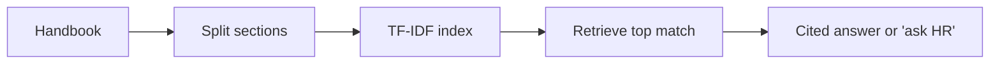

# HR Policy Q&A Bot

> Staff ask in plain English; the bot answers from the handbook and cites the section, or says it doesn't know.

     

**Sector:** HR & Internal Knowledge  ·  **Project 21 of 50** in my [AI Automation Projects series](https://github.com/Princewill106/Princewill106)

## The problem

HR answers the same questions all week: how many leave days, what's the travel allowance, who approves overtime. The handbook has the answers, but nobody reads a 40-page PDF. A chatbot that makes things up is worse than no chatbot, because policy answers have consequences.

## How it works



1. **Load** — The handbook (`handbook.md`) is split into sections by heading.
2. **Index** — A TF-IDF index is built over the sections (no external libraries).
3. **Retrieve** — Each question is scored against every section with cosine similarity.
4. **Answer** — The best section's most relevant sentences are returned with the section name as a citation; an LLM can phrase the answer when configured, but only from the retrieved text.
5. **Refuse** — Below a confidence threshold the bot says it isn't sure and routes the question to HR.

## Features

- Dependency-free TF-IDF retriever
- Answers cite the handbook section
- Low-confidence refusal and HR routing
- Grounded LLM mode (answers only from retrieved text)
- Interactive mode (`--ask`)

## Quick start

```bash
git clone https://github.com/Princewill106/hr-policy-qa-bot.git
cd hr-policy-qa-bot
python main.py --demo
```

No installs needed: it uses only the Python standard library. The demo runs fully offline using the sample data in this repo.

**Optional: plug in an LLM.** Copy `.env.example` to `.env` and add an Anthropic or OpenAI key. The project will then use the model for the language-heavy steps and fall back to its rule-based logic if a call fails.

Run the tests:

```bash
python -m unittest -v
```

## Sample output

```text
Q: How many annual leave days do I get?
A: Full-time staff receive 20 working days of annual leave per year. Leave accrues monthly and up to 5 unused days can be carried into the next year.
   source: Annual leave (confidence 0.57)

Q: What is the transport allowance for client visits?
A: Transport for client visits within Lagos is reimbursed up to NGN 15,000 per day with receipts. Inter-state travel requires a travel request approved by the operations manager, and hotel stays are capped at NGN 60,000 per night.
   source: Travel and transport (confidence 0.35)

Q: Who approves overtime?
A: Overtime must be approved in advance by your head of department. Approved overtime is paid at 1.5 times the hourly rate or taken as time off in lieu within one month.
   source: Overtime (confidence 0.57)

Q: Can I work from home on Fridays?
A: Staff may work remotely up to two days per week with their manager's approval. Fridays are remote-friendly by default unless a client meeting is scheduled.
   source: Remote work (confidence 0.41)

Q: What's the company's stance on crypto investments?
A: I'm not sure the handbook covers that. I've passed your question to HR.
   source: - (confidence 0.19)
```

## Use it in n8n (no code needed)

[`n8n-workflow.json`](n8n-workflow.json) is a ready-to-import n8n version of this project, built for n8n 1.x.

1. In n8n, open **Workflows → Import from File** and choose `n8n-workflow.json`.
2. Click **Test workflow**. It runs the full logic on the sample data built into the *Sample data* node, so you can see the results before connecting anything.
3. Open each output node and connect your accounts: Slack. For Google Sheets, pick your spreadsheet and sheet.
4. Adjust the settings at the top of the **Logic** node (thresholds, templates, contacts), then **Activate**.

**Flow:** **Webhook** (`POST /webhook/hr-question`) → **Logic** (Code node) → **Route** (Switch)

**Outputs:**
- Forward to HR (Slack)

The Logic node is a JavaScript port of the rules in `main.py`, so you can run the project in n8n without Python.

## Use it on your own data

Replace `handbook.md` with your policy (use `##` headings per section) and run `python main.py --ask "How many sick days do I get?"`, or `python main.py --demo` for the sample questions.

## Project structure

```text
n8n-workflow.json            Importable n8n workflow
.env.example                 Optional API key settings
.gitignore                   Git ignore rules
LICENSE                      MIT license
README.md                    This file
handbook.md                  Reference / config data
llm.py                       Optional LLM helper (offline fallback)
main.py                      Entry point and core logic
requirements.txt             Dependencies (stdlib only)
test_main.py                 Unit tests
```

## Who this is for

- HR teams at SMEs and schools
- Internal Slack/WhatsApp helpdesk bots
- Anyone learning how RAG works under the hood

## Ideas to extend it

- [ ] Embeddings-based retrieval
- [ ] Slack and WhatsApp front-ends
- [ ] Log unanswered questions to improve the handbook
- [ ] PDF handbook ingestion

## About

Built by **Ogbu Ugochukwu Princewill**, AI Automation Lead and robotics engineer. I teach people and businesses to build with AI, not just talk about it. [LinkedIn](https://www.linkedin.com/in/ugochukwu-ogbu-653a0816a)

If this helped you, give it a ⭐ and share what you built with it.

## License

MIT — see [LICENSE](LICENSE).
